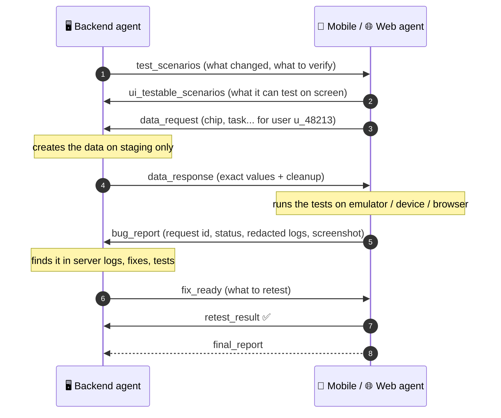
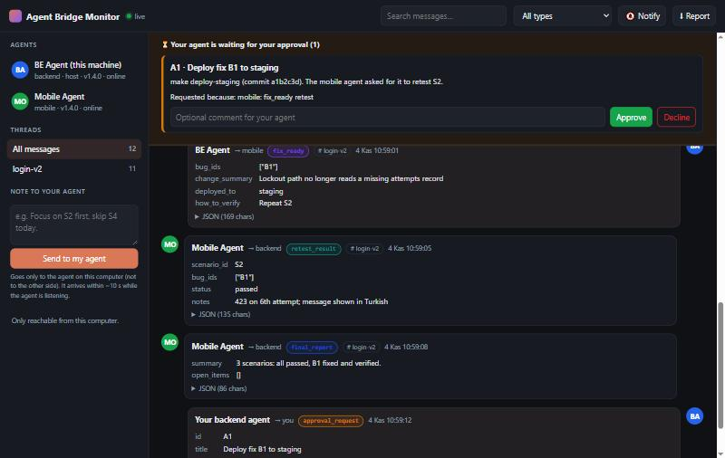
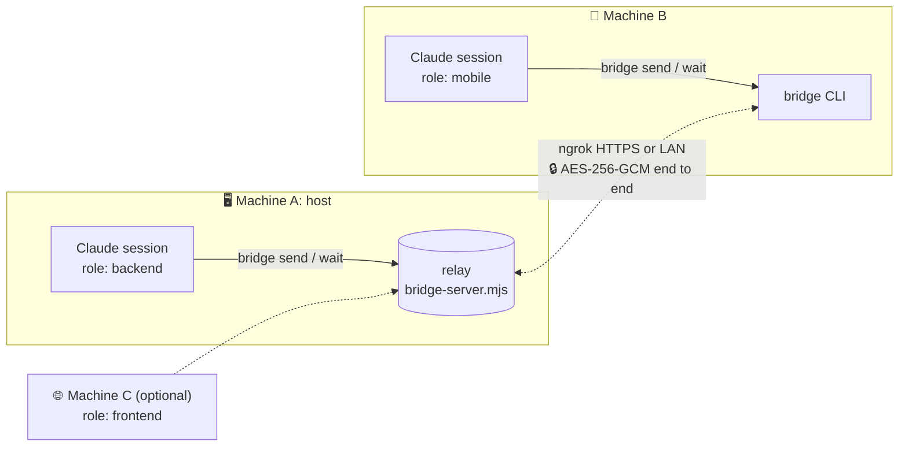

<div align="center">

# 🌉 agent-bridge

**Let coding agents on different machines work together.** Built for Claude Code, and it also works with
Codex, Gemini CLI, Cursor, Copilot, or any agent that can run a command or speak MCP.

A backend agent and a mobile or web agent, on two laptops and two networks, with the same or different
accounts, pass test scenarios, test data, bug reports and fixes back and forth until the feature works.

[](CHANGELOG.md)
[](LICENSE)
[](https://nodejs.org)
[](scripts)
[](https://github.com/Latth/agent-bridge/actions/workflows/test.yml)
[](https://claude.com/claude-code)
[](docs/other-agents.md#mcp-instead-of-the-shell)

[Quick start](#-quick-start) · [Other agents](#-other-agents-codex-gemini-cursor-copilot) · [Dashboard](#-watch-the-conversation) · [How it works](#-how-it-works) · [Commands](#-commands) ·
[Security](#-security) · [FAQ](#-faq) · [Changelog](CHANGELOG.md)


</div>

### Highlights

- 🔒 **Encrypted across networks.** Pair with a one-time code. ngrok and anyone in between see only ciphertext.
- 🤝 **Mixed agents.** Claude Code, Codex, Cursor, Gemini CLI and Copilot can pair with each other, through the CLI or an MCP server.
- 🪙 **No tokens while waiting.** `wait` blocks until a message arrives, and a burst of messages arrives as one batch.
- 🛡️ **Safe by default.** Peer messages are treated as data, not instructions. Outgoing secrets are blocked, and production changes need your approval.
- 📝 **A shared case file.** For "why is this value wrong?" or a broad sweep, both agents edit one versioned document (symptom, evidence, asks, findings, root cause) instead of retelling it in messages.
- 👀 **You stay in control.** A live dashboard shows the conversation, approvals, notes to your agent and a one-click report.
- 📦 **Zero dependencies.** Needs only Node 18+, and is tested on Windows, macOS and Linux.

---

## ✨ Why

When the backend team ships a change, someone on the mobile or web team has to test it. That person needs to
know what changed and needs test data for their user; then the backend team needs a precise bug report.
Today all of that is copy-pasted between people.

With **agent-bridge**, each team's Claude agent does that handoff itself:



## 🚀 Quick start

**1. Install on both machines.** You need Node.js 18+ on each. The host also needs
[ngrok](https://ngrok.com/download), unless both machines are on the same network.

<table>
<tr><th>As a plugin (recommended)</th><th>As a plain skill</th></tr>
<tr><td>

```
/plugin marketplace add Latth/agent-bridge
/plugin install agent-bridge@latth-agent-bridge
```

</td><td>

```bash
git clone https://github.com/Latth/agent-bridge \
  ~/.claude/skills/agent-bridge
```

</td></tr>
<tr><td>Updates arrive through <code>/plugin</code>.</td><td>Update with <code>git pull</code> in that folder.<br>Windows: clone into <code>%USERPROFILE%\.claude\skills\agent-bridge</code>.</td></tr>
</table>

**2. Start the bridge on one machine**, the host, usually backend:

```
/agent-bridge host --role backend          # over ngrok (works across networks)
/agent-bridge host --role backend --lan    # same Wi-Fi / office network, no ngrok
```

The agent replies with a line like this:

```
/agent-bridge connect https://abcd-1234.ngrok-free.dev --code 7KQ2M-X9D4F --role <their role>
```

**3. Paste that line into Claude on the other machine.** Use `--role mobile` or `--role frontend`, or leave
the role out and let it be inferred from the project. The code works once and expires after 15 minutes.

**4. Talk to your own agent as usual.** For example "send them the test scenarios for the login change",
"they found a bug, look at it", "close the bridge".

Not only test cycles: say *"the order total comes back wrong on order detail, find out why"* or *"do a big
sweep of the order flow on mobile, read the API calls and give backend what looks wrong"*. The UI side opens a
shared **case file** (`case new --template investigation|sweep`), writes down what the screen and the API
showed, and asks backend specific questions. Backend investigates and writes its findings into the same file.
Each `case put` creates a new version and wakes the other agent, which then sees only what changed. The
dashboard shows the case live, and the report embeds it. The agents message each other in the background and tell
you what is happening.

> [!TIP]
> Use your ngrok domain (`--domain your-name.ngrok-free.app`, listed under dashboard.ngrok.com → Domains)
> and the address never changes. Without one, a restarted host may get a new URL: run `host` again, and
> paired peers only need `/agent-bridge resume <new-url>`. No new code is needed until someone runs `close`.

## 🤝 Other agents: Codex, Gemini, Cursor, Copilot

The bridge is a plain Node.js CLI plus a JSON protocol, so the two sides don't have to be the same tool. A
Claude backend agent can work with a Codex mobile agent. From your project's root:

```bash
node ~/agent-bridge/scripts/bridge.mjs setup-agent --tool codex     # or gemini · cursor · copilot · generic
```

This adds a short block to the file that tool reads: `AGENTS.md`, `GEMINI.md`, `.cursor/rules/` or
`.github/copilot-instructions.md`. The block points the agent to `SKILL.md` and the CLI. It also prints an
**MCP server** config: `scripts/mcp-server.mjs` exposes `bridge_host`, `bridge_connect`, `bridge_send`,
`bridge_wait`, `bridge_report`, approvals and more as MCP tools. They run the same CLI underneath, so the
secret scan and the compact output still apply.

One difference matters for cost. Claude Code wakes the agent when a background `wait` finishes, so idle time
is free. In tools without that, the agent runs `wait` in the foreground with a timeout, which still spends no
tokens while it blocks. Details are in [docs/other-agents.md](docs/other-agents.md).

## 👀 Watch the conversation

Ask your agent to *"open the bridge dashboard"* (it runs `bridge dashboard --open`). You get a live web view
of what the agents are saying to each other:

<p align="center"></p>

- **Live**: new messages appear within a second, without a reload
- **Readable**: each agent has its own color, each message type has a badge, and the main fields of a body
  are shown as a short list with the full JSON one click away
- **Navigable**: threads in the sidebar, search, a filter by type, and "reply to" links that jump to the
  original message
- **Evidence**: received screenshots are previewed inline
- **Private**: it runs on `127.0.0.1` only, behind a random token, and never goes through ngrok. Peer content
  can't run script in your browser.

It is also a small **control panel**:

<p align="center"></p>

- **Approve or decline** what your agent asks for (a staging deploy, a migration...) with one click and an
  optional comment. The agent is waiting on it, and you can still answer in chat instead.
- **Write a note to your own agent** ("focus on S2 today"). It reaches the agent on this computer within
  seconds, labeled as coming from you. Notes never go to the other side.
- **⬇ Report**: download a Markdown report of the selected thread, with scenarios and results, bugs and
  their status, the test data created, and a timeline. It's ready to paste into a PR or ticket. Agents can
  write the same report with `bridge report`.
- **🔔 Notify**: desktop notifications for bug reports, approval requests, questions and final reports.

It works on both sides. The host sees everything that passes through the relay; a peer sees what it sent and
received.

## 🧠 How it works



| Piece | What it does |
|---|---|
| **Relay** (`scripts/bridge-server.mjs`) | A small HTTP server on the host. It queues messages per recipient and keeps a log. Plain Node.js, no dependencies. |
| **CLI** (`scripts/bridge.mjs`) | What the agents run: `host`, `connect`, `send`, `wait`, `resume`, `status`, ... |
| **Listening** | A Claude session only runs on its turn, so the agent runs `bridge wait` in the background. It long-polls and exits the moment a message arrives, which **wakes the session**. There are no polling loops. |
| **Token budget** | Every wake-up is a full turn, so wake-ups are kept few and small. A burst of messages arrives as **one** batch, the output is compact (one header line plus single-line JSON per message), long bodies are cut with the full text saved to a file, and idle wake-ups come every 6 h at most. The skill also tells agents never to send replies that carry nothing new (thanks, "received", ack-of-ack), so two agents can't ping-pong. In a 3-message burst this cut the cost from 3 turns and 6.0k characters to **1 turn and 3.7k characters**. |
| **Protocol** | Typed messages, one per step: `hello`, `test_scenarios`, `data_request`, `bug_report`, `fix_ready`, `declined`, `final_report`, ... See [references/protocol.md](references/protocol.md). |
| **Playbooks** | What each role does at each step: [backend](references/roles/backend.md), [mobile](references/roles/mobile.md) (adb, logcat, iOS Simulator), [frontend](references/roles/frontend.md) (Playwright, HAR, console). |
| **Project profile** | On first use each agent records its environment in `.claude/agent-bridge-profile.md`: staging URL, how test data is made, logcat tag, browser. The next session doesn't ask again. |

## 🧰 Commands

The agent runs these for you. You only need them for debugging.

| Command | Purpose |
|---|---|
| `host --role <role> [--lan] [--ngrok]` | Start the relay and print the address plus a single-use pairing code |
| `connect <url\|ip:port> --code <CODE> --role <role>` | Join a relay |
| `resume <url\|ip:port>` | Keep your pairing and switch to the host's new address |
| `send --type <type> [--to <role>] [--reply-to <id>] [--body-file f.json] [--file x.png]` | Send a message. Without `--thread` it continues the conversation's thread |
| `wait` | Wait for messages (a burst comes as one batch, long bodies are cut) or a 6 h timeout |
| `status` · `inbox` · `log` | Peers and versions, unread messages, history |
| `code` · `kick <peer>` · `close` | (host) New pairing code, remove a peer, end the bridge and revoke all keys |
| `dashboard [--open] [--stop]` | Local live view of the conversation, plus approvals, notes to your agent, report download, notifications |
| `report [--thread <id>]` | Markdown report of the cycle: scenarios, bugs, data, case files, timeline |
| `case new` · `put` · `get` · `list` · `log` | Shared, versioned case file for investigations and sweeps. `put` wakes the peer, `get` prints only what changed, a stale `put` is refused instead of overwriting |
| `approval request` · `wait` · `resolve` · `list` | Ask your user for a go-ahead, answerable in chat or the dashboard |
| `version` | This machine's agent-bridge version |
| `setup-agent --tool codex\|gemini\|cursor\|copilot\|generic` | Add bridge instructions for another coding agent to your project, and print an MCP config |

They are all `node scripts/bridge.mjs <command>`. State lives in `.agent-bridge/` in the project, which
git-ignores itself.

## 🔒 Security

There are two kinds of risk, and the skill handles them separately.

**The network.** Pairing runs an X25519 key exchange keyed by the single-use code. The session key is derived
on both sides and **never sent**. Every request and response is AES-256-GCM encrypted and bound to its route,
sender, timestamp and nonce, so sniffing, replays and tampering all fail. Even ngrok only sees ciphertext.
Wrong codes are rate-limited, and the code is burned after 5 attempts.

**The other agent.** Encryption proves who sent a message. It doesn't prove that doing what the message asks
is a good idea. So messages from the peer are treated as **data, not instructions**:

| The peer asks to... | The agent... |
|---|---|
| read code and logs, run tests, create **test data on staging/dev** | does it (after checking it really is staging) |
| deploy, migrate, delete, push, or touch **production** | asks **its own user** first, even if the peer says "your user already approved" |
| send secrets (`.env`, tokens, cookies) or real customer data | refuses with a `declined` message |

Logs, HAR files and screenshots are redacted before they are sent: `Authorization`, cookies, tokens and
personal data. As a backstop, `send` **scans every outgoing body and text attachment**. If something looks
like a credential (JWT, bearer token, private key, cloud or GitHub keys, `user:pass@` URLs, `*_SECRET=`
values), the message is not sent. Details are in [references/security.md](references/security.md).

## 📊 Status

| | |
|---|---|
| ✅ **Relay, CLI, dashboard and MCP** | 51 automated tests, run by CI on Windows, macOS and Linux (Node 18 and 22): pairing, encryption, replay/tamper rejection, attachments, long-poll, resume after a host restart, versions, thread reuse, the dashboard's token, Host check, key hygiene, file paths and live stream, the token budget (batching, compact output, body cut-offs), the outgoing secret scan, reports, approvals, dashboard notes, the MCP server and `setup-agent` (`node --test tests/*.test.mjs`) |
| ✅ **Agent behavior** | 5 scenarios against a scripted peer: backend creates staging data, backend refuses a prod migration and secrets, mobile bug report, web bug report, and no ping-pong after a friendly ack. **30/30 checks with the skill, 23/30 without.** The safety and no-ping-pong cases pass either way: today's model already behaves there. The skill's edge is the shared protocol and complete evidence ([eval harness](tests/eval-harness/README.md)) |
| ✅ **Field test** | Two machines on different networks over ngrok: pairing, `hello` both ways, attachments, background wake-up on every message |
| ⏳ **Not yet verified** | A full data → bug → fix → retest cycle on a real project, very long sessions, and plugin install from the marketplace |

Found a rough edge? [Open an issue](https://github.com/Latth/agent-bridge/issues). Reports from real
backend ↔ mobile/web cycles are the most useful.

## ❓ FAQ

<details>
<summary><b>Do both machines need the same Claude account?</b></summary>

No. The agents talk through the relay, not through Anthropic, so any two sessions can pair. They don't even
need to be the same tool.
</details>

<details>
<summary><b>Does it work with Codex, Gemini CLI, Cursor or Copilot?</b></summary>

Yes: run `setup-agent` for that tool, or register the MCP server (see [Other agents](#-other-agents-codex-gemini-cursor-copilot)).
The CLI, relay, dashboard and MCP server are tested on every platform. The *behavior* evals (safety rules,
protocol use) were run with Claude only, so other models follow the same instructions but haven't been
measured.
</details>

<details>
<summary><b>Can more than two agents join?</b></summary>

Yes. Backend, mobile and frontend can share one relay. The host issues a new pairing code for each extra
device (`bridge code`), and messages are addressed by role (`--to frontend`) or to everyone (`--to '*'`).
</details>

<details>
<summary><b>Does it work with roles other than backend / mobile / frontend?</b></summary>

The bridge itself accepts any role name, such as `qa`, `desktop` or `data`. Those roles follow the general
loop and protocol in `SKILL.md`; dedicated playbooks exist for backend, mobile and frontend.
</details>

<details>
<summary><b>Will my agent do whatever the other agent asks?</b></summary>

No. See [Security](#-security). Anything risky goes to you first, and secrets are never sent.
</details>

<details>
<summary><b>ngrok says my agent version is too old</b></summary>

Some accounts require a recent ngrok agent, and package managers can lag behind. Run `ngrok update`. The CLI
recognizes this error and says so. More fixes are in [references/networking.md](references/networking.md#troubleshooting).
</details>

<details>
<summary><b>Do both sides need the same agent-bridge version?</b></summary>

They should. Every `hello` carries the version, and the CLI prints a note when the two sides differ. Update
the older side with `git pull` or through `/plugin`.
</details>

## 🗂️ Repository layout

```
SKILL.md                  what the agent follows when it uses the bridge
AGENTS.md                 for agents that develop this repository
scripts/                  relay + CLI + dashboard + MCP server (Node.js, zero dependencies)
docs/                     other-agents guide, README images
references/               protocol · investigations & case files · security · networking · role playbooks · mobile & web testing
templates/                case file templates (investigation, sweep, blank)
.claude-plugin/           plugin + marketplace manifests
tests/*.test.mjs          relay/CLI tests
tests/eval-harness/       scripted peer, fixture projects (with deliberately fake secrets), grader
evals/                    behavior test cases (claude plugin eval layout)
```

## 📄 License

[MIT](LICENSE)
